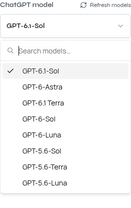
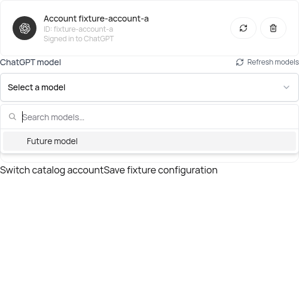

# ChatGPT model discovery

Presenton obtains ChatGPT/Codex models from the connected account instead of a built-in model allowlist. The same backend catalog validates selections in Settings, onboarding, and generation. This integration uses ChatGPT sign-in (`LLM=codex`), independently of OpenAI API-key model discovery.

## Choosing a model

1. Sign in with ChatGPT from Settings or onboarding. For a remote installation, return to the original Presenton tab and submit the full localhost callback URL if the browser cannot reach the callback listener.
2. Choose a model from the account's catalog and save the settings. A new connection does not silently choose a model for you.
3. Use **Refresh models** to request a fresh catalog. Token refresh and model refresh are separate controls.

The selected ID is preserved exactly across saves and restarts. A model missing from a successfully loaded catalog is shown as unavailable; an unsuccessful refresh does not erase the selection. Choose an available model before generating. Explicitly signing out retains the existing behavior of clearing the ChatGPT model selection.

An administrator configures the shared provider for the installation. Web model discovery requires the native admin browser session; ordinary users and API keys cannot access the discovery endpoint. Electron uses its existing trusted desktop-request protection.

Settings in the packaged Electron runtime (account details excluded):

Onboarding component test with synthetic account/model data, demonstrating a model absent from the previous registry (the bottom controls belong to the test harness):

## Discovery contract

`GET /api/v1/admin/codex/models` returns an object with `models` and `client_version`. Each model includes its exact `id`, `name`, and available metadata such as `context_window`, `input_modalities`, and `supported_reasoning_levels`. OAuth credentials, account identifiers, and upstream model instructions are excluded from this response.

The server requests `https://chatgpt.com/backend-api/codex/models?client_version=0.169.0` using the connected ChatGPT access token and account header where applicable. `0.169.0` is the reviewed protocol compatibility version, not Presenton's release version. See the [official Codex catalog documentation](https://learn.chatgpt.com/docs/enterprise/roll-out-a-gateway#fetch-current-upstream-defaults).

Only entries with `visibility=list` are offered, ordered by priority and then exact ID. `supported_in_api` does not filter a ChatGPT account's models. Additional upstream fields do not become application settings or prompts.

Catalog responses are `private, no-store`. Presenton does not persist the catalog or maintain a cross-request TTL cache. The UI holds its current display state only for the active page; the server resolves a fresh catalog for each configured-client operation. URLs are fixed server-side, redirects are disabled, and connect/read timeouts are 5/15 seconds.

The shared resolver captures credentials, selected model, and generation settings together. It validates the model against that account's catalog and passes the same exact ID to the SDK. Async callers offload synchronous resolution; synchronous templates use the same resolver directly. Credentials refresh is serialized per revision, and revision-checked writes prevent late refresh/login results or stale settings mirrors from replacing newer state.

## Capabilities and failures

Reasoning choices are the intersection of the catalog's levels and the installed SDK's supported values. A new upstream level, such as `ultra`, does not make the other models unavailable, but is not offered until the SDK can express it. Unsupported explicit overrides produce a controlled error. Reset legacy reasoning overrides to model defaults when switching to incompatible settings.

The editor uses the catalog's effective `context_window` when available; an explicit `LLM_CONTEXT_WINDOW` still takes precedence. An experimental `max_context_window` is not treated as the effective limit. The catalog does not prove a maximum output length or general JSON/function-tool support. Unknown capabilities remain unknown, and actual provider incompatibilities are reported without changing the model. The current ChatGPT transport does not enforce `LLM_MAX_OUTPUT_TOKENS` as a hard provider limit; the UI does not present a guessed SDK default as a verified model maximum.

Changing the active Codex model/provider or its reasoning settings is validated before the requested settings are written. An unrelated settings patch does not depend on catalog availability. OAuth refresh remains a separate managed-credential transaction: successful token rotation is retained even if subsequent model validation rejects a settings change.

Missing/expired authorization returns `401` with the existing `X-Presenton-Auth-Action: codex-reauth` marker. Unsupported selections return `400`; invalid upstream catalogs or other unsuccessful upstream responses return `502`; transport failures and rate limits return `503`. A valid empty catalog is an empty model list. Raw upstream error bodies are not included in diagnostics, and failures never fall back to a different model.

## Verification

Backend tests cover a model absent from the SDK registry, exact outbound IDs through the real SDK serializer, malformed/empty catalogs, auth boundaries, capability handling, rejected-save atomicity, and concurrent refresh/account/settings transitions. Node and Cypress tests exercise both UI flows, selection persistence, failures, and stale responses.

Run the repository's `./test-local.sh` for the shared checks. Electron additionally requires `npm run dev` and `npm run build:all` from `electron/`. Use a disposable checkout and a private isolated user-data profile: Electron development computes its own application-data paths, so setting only `APP_DATA_DIRECTORY` does not isolate it. Keep real credentials out of fixtures, source control, screenshots, and logs. Test discovery and actual inference separately; a successful catalog request is not an inference acceptance result.
